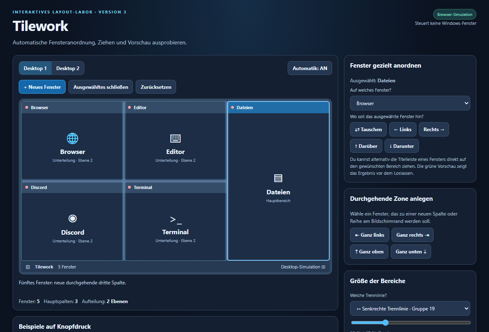
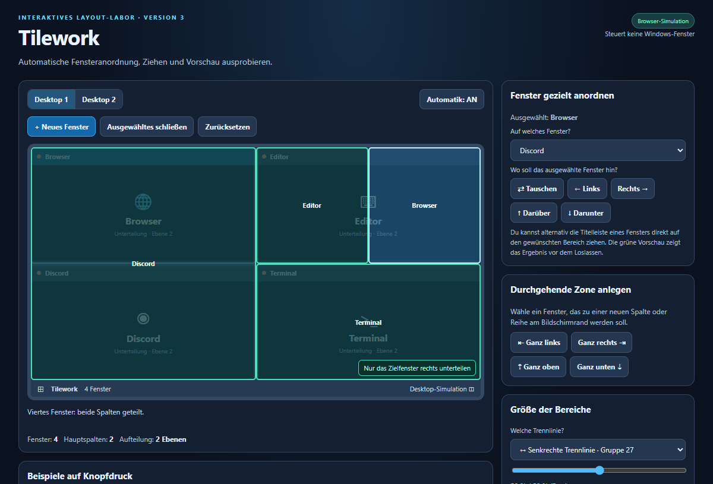

# Tilework

[](https://github.com/Jas0nOW/Tilework/actions/workflows/ci.yml) [](LICENSE)

Tilework automatically arranges Windows apps into tiles. Drag by the title bar to swap two windows, split one tile, or make a zone along a screen edge. The preview shows the resulting layout before you release.

> **0.3.0 release candidate.** See the [release verification matrix](docs/RELEASE.md) for tested behavior and open Windows checks.

## Try the interactive V3 demo

Open [the browser demo on GitHub Pages](https://jas0now.github.io/Tilework/demo/) once Pages is enabled. Until then, open [the standalone HTML file](docs/demo/index.html) in your browser from a local checkout.

The demo is a single-monitor simulation. Add five windows to see the layout progression, then drag one to a different tile or a screen edge.

| Automatic layout | Drag preview |
|---|---|
|  |  |

## Install on Windows

1. Download `Tilework-Setup-x64.exe` and `SHA256SUMS.txt` for the same version from [Releases](https://github.com/Jas0nOW/Tilework/releases). The candidate targets x64 Windows 10 22H2 and Windows 11.
2. In PowerShell, run `Get-FileHash -Algorithm SHA256 .\Tilework-Setup-x64.exe` and compare the hash with the published value. The candidate is unsigned, so Windows may show an unknown publisher. A matching hash verifies the downloaded bytes against the published checksum.
3. Run Setup as your usual user and launch **Tilework** from the Start menu. Setup defaults to `%LOCALAPPDATA%\Programs\Tilework`.
4. To launch at sign-in, enable **Start with Windows** from the tray menu. Autostart is off by default and Windows may delay or disable it in Startup Apps.

For a portable run, download `Tilework-Portable-x64.exe` and launch it directly. Both variants store settings and diagnostics in `%LOCALAPPDATA%\Tilework`.

### Migrate from the earlier development build

1. Exit the old Tilework from the tray.
2. In **Task Scheduler**, check the root **Task Scheduler Library** for a task named exactly `Tilework`. The old task had **Run with highest privileges** enabled, one **At log on** trigger, and one **Start a program** action pointing to the old Tilework executable. Match the full action path to the copy you previously started, and check that the task runs under the account that enabled it. Then disable and delete that task. Use administrator approval if Windows requires it. Check the task even if the executable has already been removed or was run from a portable location. Leave unrelated or uncertain tasks in place and have their owner review them.
3. Remove the old Start menu shortcut if it remains. Remove `tilework.exe` and `tilework.exe.old` from `%LOCALAPPDATA%\Tilework` if present. Keep `config.ini` to carry your settings forward.
4. Run the new installer and re-enable **Start with Windows** if desired.

Setup stops when it finds legacy executable files or a visible scheduled task matching the old name and structure. Setup leaves tasks untouched. If the previous task was registered from an elevated account, check Task Scheduler from that account before installing.

### Update or roll back

Use **Check for updates…** in the tray or `--check-update` from a terminal. The check reports newer public stable releases with the expected installer. Beta testers can check the Releases page for prereleases.

Exit Tilework, verify the checksum for the desired version, then run its installer. Keep a previous verified installer and a backup of `config.ini` if you need to roll back. Exit Tilework and reinstall that version. The app delegates downloads and installation to the user and the standalone installer.

### Uninstall

1. Select **Exit** from the Tilework tray menu.
2. In **Settings → Apps**, select **Tilework → Uninstall**. The uninstaller removes the program, shortcuts, and Tilework's sign-in entry.
3. To remove retained user data, first restore Windows Snap if a previous crash left it disabled. Then remove `%LOCALAPPDATA%\Tilework` if you no longer need its settings or logs. If you used the former **CosmicTile** build, you can also remove its old settings folder. Portable users can remove the downloaded executable after exiting.

## Use Tilework

| Action | Control |
|---|---|
| Pause or resume for this desktop | Tray icon or `Win + Y` |
| Swap tiles | Drag the title bar to the centre of another tile |
| Split one tile | Drag to the edge of another tile |
| Create a full-length zone | Drag to the screen edge |
| Resize a divider | Drag a boundary of a tiled window |
| Change focus-on-hover | Tray menu or `config.ini` |

Settings default to focus on hover after 300 ms, minimum tile size 260×160 px, and verbose logging off. Manual settings edits apply on restart. Diagnostic files include `tilework.log` and one rotated backup. See [DESIGN.md](docs/DESIGN.md) for the layout and recovery rules.

Windows prevents standard-user Tilework from managing elevated windows. App minimum sizes, foreground restrictions, and ambiguous virtual desktop information can also limit tiling. Verify mixed-DPI monitors, pinned windows, and Explorer recovery before depending on those workflows.

### Diagnostics

| Argument | Effect |
|---|---|
| `--version` | Show the executable version |
| `--dump` | Print eligible windows and proposed bounds without moving them |
| `--filter TEXT` | Run with management restricted to matching window titles |
| `--snap-status` | Read the current Windows Snap setting |
| `--restore-snap` | Enable Windows Snap and clear a recovery marker after Tilework has exited |
| `--autostart-on`, `--autostart-off`, `--autostart-status` | Manage or inspect the current user's sign-in entry |

Review diagnostic output before sharing it. `--dump` can contain window titles.

## Build

Use Rust 1.100.0 with the Windows MSVC toolchain. The locked dependency graph is checked in.

```powershell
cargo test --locked
cargo clippy --locked --all-targets -- -D warnings
cargo build --locked --release
```

See the [release runbook](docs/RELEASE.md) for packaging and live tests, [CONTRIBUTING.md](CONTRIBUTING.md) for contributions, and [SECURITY.md](SECURITY.md) for private vulnerability reporting. Tilework uses the [MIT license](LICENSE).
